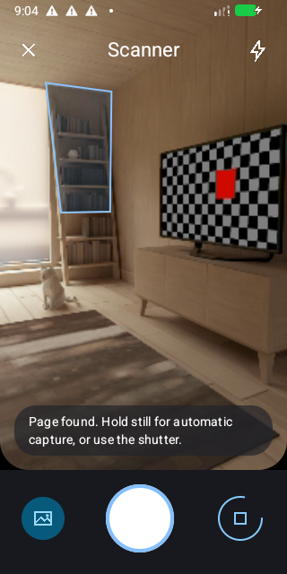
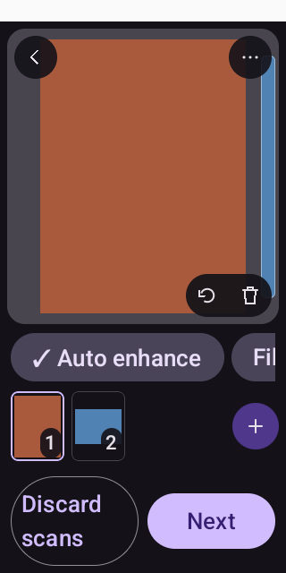

# Open Android Doc Scanner

An offline Android SDK for scanning documents, cards and printed photos. Add the Compose scanner to an app, or use the image processing and export modules with your own interface.

<a href="https://github.com/phillip9933/open-android-doc-scanner/releases/tag/v1.1.0"></a>

**Support:** [Buy me a coffee](https://buymeacoffee.com/phillip9933) · [GitHub Sponsors](https://github.com/sponsors/phillip9933)

## Features

- Detect page edges in the camera preview, capture automatically when the page is steady, and let the user correct the crop.
- Adjust contrast and reduce shadows and show-through on documents. Use Photo mode to preserve color and detail on printed photos.
- Review and reorder pages, export a PDF or page images, or capture the front and back of a card.
- Read printed English and Japanese text with the optional OCR module. It returns text, word positions and confidence scores. The host app supplies the language files and decides how to use the results.

## Screenshots

These Android emulator captures show the sample app with synthetic pages. The camera is from RC4 and the review screen is from RC10.

 

See the [scanner design and capture details](docs/design.md).

## Add the SDK to an app

The SDK supports Android 8.0 (API 26) and later on `arm64-v8a` and `x86_64`. Download the Maven ZIP and `SHA256SUMS` from the [1.1.0 release](https://github.com/phillip9933/open-android-doc-scanner/releases/tag/v1.1.0). In the download directory, run `sha256sum --check SHA256SUMS`. Extract the ZIP and add its `maven` directory to the host’s Gradle repositories. Use version `1.1.0` for all scanner modules. See the [release notes](docs/RELEASE-1.1.0.md) and [integration guide](docs/INTEGRATION.md).

## Roadmap and work

Follow the [public roadmap and work board](https://github.com/users/phillip9933/projects/1), [release milestones](https://github.com/phillip9933/open-android-doc-scanner/milestones), and [issues](https://github.com/phillip9933/open-android-doc-scanner/issues). Work status and release maturity are separate; dates are estimates. See [the tracking convention](CONTRIBUTING.md#work-tracking-and-release-policy).

## About this project

I build projects to solve problems I run into in my own life. I share them because I believe in open source and hope others can learn from them, adapt them or find them useful.

Making it public does not mean it is a polished production product or suitable for every setup. Please read the documented limitations and decide whether it fits your needs. I'm happy to help where I can, but I can't promise a support schedule.

## Build

Requirements: JDK 17 or 21, Android SDK platform 36, AGP-selected build tools, NDK 28.2.13676358, public Google/Maven Central dependencies. Create an untracked `local.properties` with `sdk.dir=...` or set `ANDROID_HOME`. Run:

```sh
python3 tools/prepare_ocr_test_models.py
./gradlew :scanner-core:test :scanner-camera:testDebugUnitTest :scanner-sample:assembleDebug lint
./gradlew :scanner-processing-opencv:connectedDebugAndroidTest :scanner-export:connectedDebugAndroidTest
```

To run the sample on a test device or emulator, use `./gradlew :scanner-sample:installDebug` and open **Offline Scanner**. The connected Android test command requires a supported emulator/device. Windows uses `gradlew.bat`. Min Android 26; native arm64-v8a and x86_64. No 32-bit support. The sample reopens its last completed export; it has no full scan library. Host owns naming, persistent storage, sharing and cleanup after completion.

## Optional OCR

Add `dev.offlinescan:scanner-ocr-tesseract:1.1.0` to use offline text recognition. Bundle the approved English and Japanese language files with the host app. The SDK archive includes the OCR engine. The language files for the sample debug build come from the model preparation command above. See [OCR integration and card scanning](docs/OCR.md).

## Ready-made flow

```kotlin
MaterialTheme {
    ScannerFlow(
        config = ScanConfig(mode = ScanMode.DOCUMENT, detectionMode = DetectionMode.AI),
        outputDirectory = File(context.filesDir, "scanner-output"),
        onResult = { result ->
            when (result) {
                is ScanResult.Completed -> consume(result.output)
                ScanResult.Cancelled -> closeScanner()
                is ScanResult.Failed -> showFailure(result.error)
            }
        }
    )
}
```

Consume the callback by removing the composable. Outputs stay available after session cleanup. Do not put outputs under the session/cache originals directory. Convert private files to your own FileProvider URIs for sharing; the SDK adds no storage provider or host navigation. Pass app's light/dark MaterialTheme. UI strings can be overridden/localized by hosts.

## Processing-only use

`scanner-core` exposes no Android or OpenCV types. Add `scanner-processing-opencv` for the implementation, `scanner-export` for PDF. Call processing/export on a worker thread, with cooperative cancellation. Preserve cancellation exceptions.

```kotlin
val processor: ImageProcessor = OpenCvProcessor()
ScanSession(config, privateCacheRoot, processor).use { session ->
    val page = session.`import`(hostSourceFile) // independent owned copy
    val detection = processor.detect(page.original, config, token)
    detection.corners?.let { session.update(page.id, page.edits.copy(corners = it)) }
    // Let users confirm/correct the suggested crop before saving.
    val output = AndroidExporter(processor).export(
        session.pages, hostOutputDirectory, ExportFormat.PDF, config, token,
        Progress { completed, total -> reportProgress(completed, total) }
    )
    retain(output) // host owns these committed output files
}
```

Config bounds quality/dimensions/pages/input pixels. Renders may be smaller due to decode/pixel limits; use returned actual dimensions. PDF embeds one processed JPEG page at a time, with page resolution independent of page count. Photograph mode preserves color/detail by default. Document Auto retains continuous colour or grayscale; Black and white is an explicit manual filter. Card front/back mode limits the session to two pages and supplies images only.

Read [integration examples](docs/INTEGRATION.md), [architecture and ownership](docs/ARCHITECTURE.md), [reuse assessment](docs/REUSE-DECISION.md), [third-party notices](THIRD-PARTY-NOTICES.md).


## Privacy and security

The SDK processes scans on the device and does not request internet access. Source builds using CameraX 1.7.0 include a Media3 permission to read network connection state. The sample removes it. Hosts that do not need it can use the [manifest opt-out](docs/INTEGRATION.md#camera-permissions). The Compose flow uses the camera permission for capture and the Android document picker for import. The host app controls how it stores, shares and deletes the exported files. See [security reporting](SECURITY.md).

## Contribute

Start with [Contributing](CONTRIBUTING.md) for setup and checks, and [Security](SECURITY.md) for private vulnerability reporting. The [documentation index](docs/README.md) covers integration, architecture and release evidence.

See the [page detector’s model provenance and licensing limits](docs/LEARNED-DETECTOR-RC8.md), [quality evidence](docs/QUALITY-REPORT.md), [remaining device acceptance](docs/DEVICE-ACCEPTANCE.md) and [contribution guidance](CONTRIBUTING.md#ai-usage).

## License

Original scanner code is licensed under [Apache-2.0](LICENSE). Retain [NOTICE](NOTICE) and [third-party notices](THIRD-PARTY-NOTICES.md); dependencies and model assets retain their own terms.

## AI usage

I use AI tools for analysis, implementation, tests, and documentation. I decide what ships and take responsibility for maintaining it. Project-specific testing and known limitations are documented separately.
